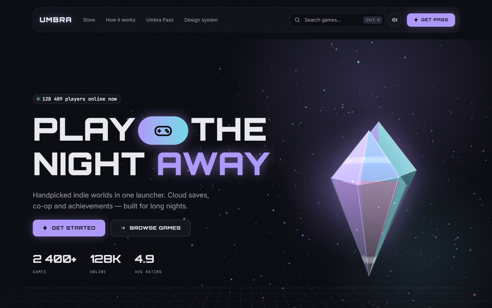
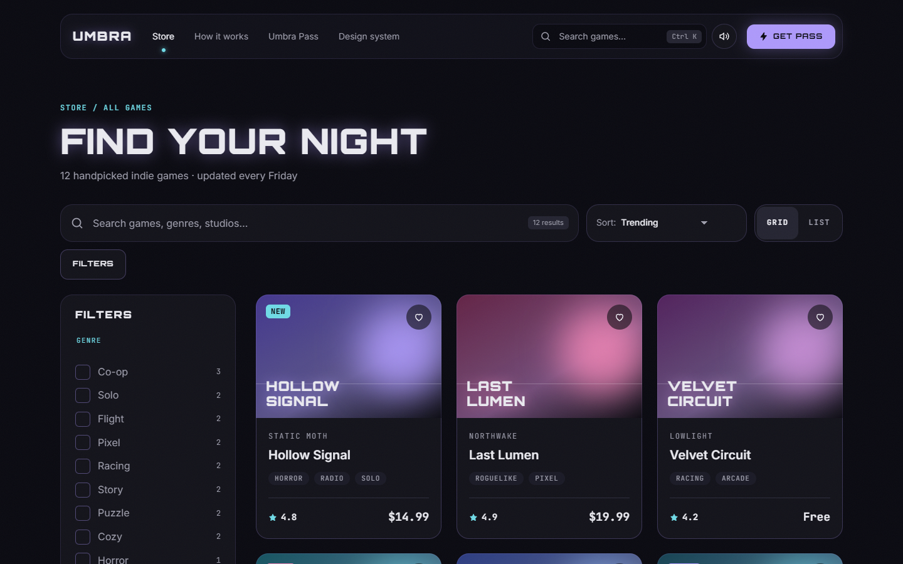
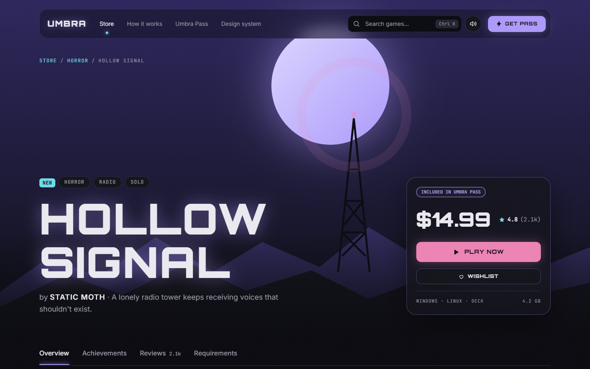
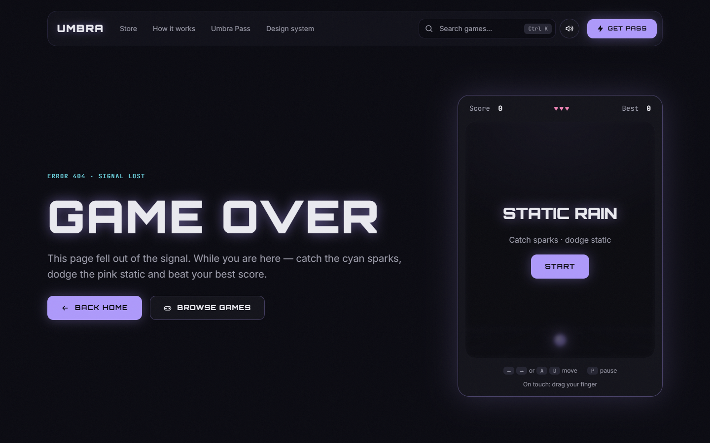
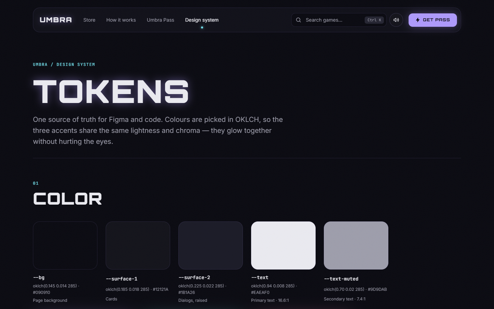
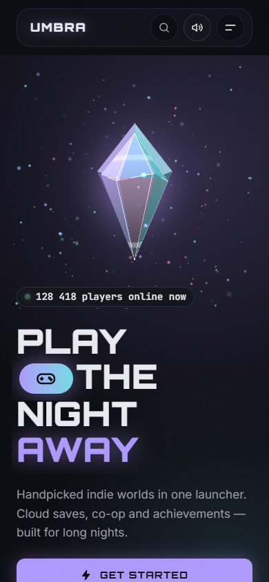

# Umbra — a fictional neon game launcher

> **Portfolio project.** Umbra is not a real store: every game, studio, price and review is made up.
> It exists to show design, 3D, animation, accessibility and clean front-end code in one place.

**Live demo:** [mikasianchick-pixel.github.io/umbra](https://mikasianchick-pixel.github.io/umbra/) ·
**Design:** Figma (tokens, components, desktop 1440 / mobile 375)



## Highlights

| What | Where | What it shows |
|---|---|---|
| **3D hero on Three.js** | `src/three/hero-scene.ts` | Faceted crystal with custom GLSL shaders, glowing particles, halo. Follows the cursor, shifts light colour on scroll, renders only while visible, drops resolution on slow devices, disposes everything on leave. Colours come from CSS tokens. |
| **Loader 0 → 100 %** | `src/components/home/Loader.astro` | Real progress (fonts + page load), then a curtain reveal. Shown once per session. |
| **Scroll animation** | `src/scripts/home.ts` | GSAP ScrollTrigger + Lenis smooth scroll: line-by-line headline, sticky “How it works” panel, count-up stats, floating-crystal parallax. |
| **Catalog** | `src/islands/Catalog.tsx` | React island: search, genre / price / rating / feature filters, sorting, grid ↔ list. Filters live in the URL (`/games?genre=Co-op`). Cards reorder with a FLIP animation. |
| **Game pages** | `src/pages/games/[slug].astro` | 12 pages generated from `src/data/games.ts`: 5-layer parallax hero, gallery lightbox (← →), achievements, reviews, CSS-only requirements switch. |
| **View Transitions** | `src/styles/base.css` | Native cross-document transitions — the card cover morphs into the game hero. No JS router. |
| **Command palette** | `src/islands/CommandPalette.tsx` | `Ctrl K` or `/`: games, pages and easter eggs `/neon`, `/retro`, `/calm`. ARIA combobox on a native `<dialog>`. |
| **Mini game on 404** | `src/game/static-rain.ts` | “Static Rain”: plain TypeScript + canvas 2D. Frame-rate independent, keyboard + touch, best score in `localStorage`. |
| **Ambient sound** | `src/scripts/ambient.ts` | Synthesized with the Web Audio API — no audio files. Off by default, `M` to toggle. |
| **Design system** | `/system` | Tokens and every component in every state, the same values as in Figma. |

| Catalog | Game page |
|---|---|
|  |  |

| 404 mini game | Design system | Mobile |
|---|---|---|
|  |  |  |

## Stack

**Astro 7** (static pages, islands) · **React 19** (only where state is needed) · **TypeScript 6** (strict) ·
plain **CSS** (`@layer`, `oklch()`, `clamp()`, container queries, `:has()`, `@property`) · **Three.js** ·
**GSAP + ScrollTrigger** · **Lenis** · ESLint + Prettier. No UI kit, no CSS framework.

## Design decisions

- **One source of truth.** Colours, spacing, radii and glows are CSS custom properties in
  `src/styles/tokens.css`, mirrored from the Figma tokens page. Even the WebGL shaders read them.
- **Soft neon palette in OKLCH.** The three accents share lightness and chroma, so they glow together
  without hurting the eyes. Hot pink is used at most once per screen.
- **Procedural art.** Game covers, screenshots and the OG image are drawn with gradients, SVG and code —
  zero image licensing, every fictional game still gets its own look.
- **Islands only where needed.** React ships for the catalog, the pricing toggle and the command palette.
  Everything else is static HTML + small scripts.

## Accessibility & performance

- Every interactive element is reachable with `Tab` and has a visible focus ring (checked page by page).
- Real form controls under the neon: switches, checkboxes and segmented controls work without JavaScript.
- `prefers-reduced-motion` turns off the loader, parallax, floating objects and 3D motion.
- Three.js is lazy-loaded on the home page only and paused when off screen.
- Fonts are self-hosted with `font-display: swap`; no third-party requests at runtime.
- SEO: Open Graph image, canonical URLs, `sitemap.xml`, `robots.txt`.

## Run locally

```bash
npm install
npm run dev       # http://localhost:4321/umbra/
npm run build     # type check + static build into dist/
npm run lint      # ESLint
```

The site is built for GitHub Pages under `/umbra/` (`base` in `astro.config.mjs`), so locally it opens at
`http://localhost:4321/umbra/`. Every push to `main` is built and deployed by `.github/workflows/deploy.yml`.
For a custom domain set `SITE_URL` and `SITE_BASE=/`. `?noloader` opens the home page without the loader.

## Project structure

```
src/
├── data/        games.ts (fictional catalogue), nav.ts, tokens.ts
├── styles/      tokens, reset, base, utilities, shared UI styles
├── components/  Astro components (Button, GameCard, Dialog, Tabs, …) and home sections
├── islands/     React: Catalog, Pricing, CommandPalette
├── three/       hero-scene.ts (Three.js + GLSL)
├── scripts/     smooth scroll, tilt, magnetic buttons, wishlist, toasts, sound
├── game/        Static Rain mini game
└── pages/       /, /games, /games/[slug], /system, 404
design/          scripts that drew the Figma mock-ups
scripts/         README screenshots and OG image (headless Chrome)
```

---

Fonts: Orbitron, Inter and JetBrains Mono (SIL Open Font License).
Umbra and all games in it are fictional; any resemblance to real games or stores is coincidental.
